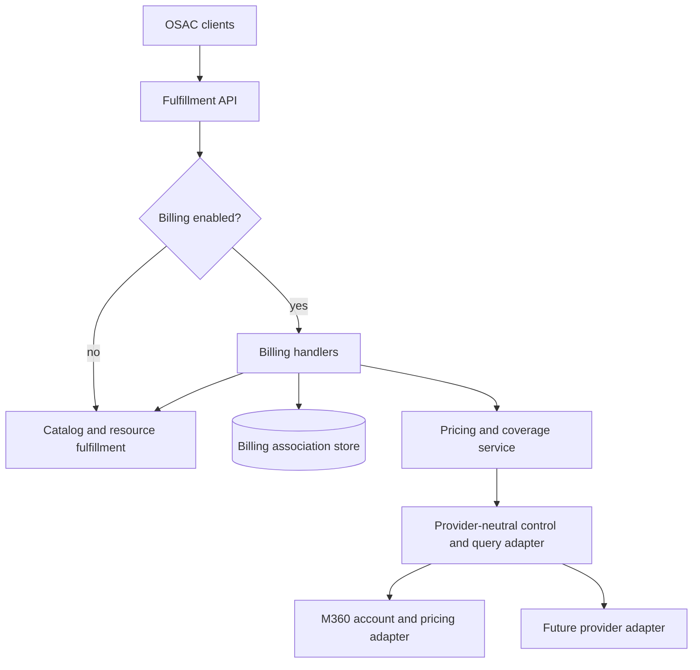

# OSAC Billing Integration and Catalog Pricing

| Field       | Value |
|-------------|-------|
| Author(s)   | Amit Oren |
| Jira        | [OSAC-3784](https://redhat.atlassian.net/browse/OSAC-3784), [OSAC-3793](https://redhat.atlassian.net/browse/OSAC-3793) |
| PRD         | [OSAC-3784 PRD](https://github.com/osac-project/enhancement-proposals/blob/main/enhancements/OSAC-3784-billing-integration-mvp/prd.md); [OSAC-3793 PRD](https://github.com/osac-project/enhancement-proposals/tree/main/enhancements/OSAC-3793-billing-catalog-pricing-integration/prd.md) |
| Date        | 2026-10-07 |

# 1. Overview

OSAC gets catalog prices and rate cards from its configured billing provider and does not store pricing details. The fulfillment service exposes one provider-neutral billing API, starting with Monetize360 (M360), so other providers can be added later. This API supports catalog pricing for VMaaS and CaaS. Billing for BMaaS remains OSAC-3795 and is out of this design.

# 2. Goals and Non-Goals

## 2.1 Goals

- Keep tenant-facing OSAC APIs and response models independent of M360 and other provider-native schemas.
- Allow a deployment to run without a billing provider while preserving normal catalog and resource fulfillment.
- Enforce a time-versioned 1:1 tenant-to-account association for this milestone (one active assignment per tenant and one active tenant per account). Sharing one account across tenants is out of this design.
- Resolve current account status and pricing/coverage in the backend, with tenant authorization enforced before provider calls.
- Provide Cloud Provider Admins a consolidated inventory of billable catalog dimensions and values, with references to the catalog items that use or offer each value, so provider rate-card completeness can be checked.
- Provide Cloud Provider Admins provider-neutral, currency-aware rate-card rows that the Rates UI can display by service, resource match, rate, and related catalog item.
- Enrich visible VMaaS and CaaS catalog list/get responses with read-time prices for default configurations, component details, account currency, freshness, and a price-may-vary indication.
- Keep catalog browsing available with or without billing. When a provider is configured, apply the coverage-gate table in §4.6: a coverage gap still blocks the gated write; a provider outage does not block launch or resize. Catalog items whose `metadata.tenant` is the reserved `shared` or `system` tenant are not coverage-checked at publish; each tenant's launch is checked against that tenant's linked account.
- Preserve the existing metering delivery path and add `correlation_id` to each usage event. During account pairing, match it against the billing provider's `externalId`, when available. `correlation_id` is not the OSAC tenant id or the provider's native `account_id`.
- Return an estimate in the account currency and provider rate unit, with hourly and monthly recurring amounts normalized using a fixed 730-hour month where the rate is time-based.

## 2.2 Non-Goals

- Create billing accounts, author rate cards, edit provider catalog data, or process payments.
- Show account balances or rated transactions in the first billing UI slice.
- Persist provider catalog prices as OSAC catalog records or create a second M360 pricing client in the catalog server.
- Run several billing providers concurrently in one deployment; a deployment may have billing disabled or configure one provider. Switching provider at a period boundary is **unsupported this milestone**.
- Estimate one-time charges or claim that prospective estimates are provider-rated actual charges.
- Convert provider prices between currencies. If a provider amount's currency differs from the linked account `base_currency`, fail the gate or return `UNAVAILABLE` pricing; do not display that amount as the account currency.
- Apply an additional billing-rounding rule to provider amounts. Preserve decimal values; UI formatting to 2–3 fractional digits is sufficient, and configurable display precision is a nice-to-have.
- Price or gate BMaaS ([OSAC-3795](https://redhat.atlassian.net/browse/OSAC-3795)).
- Declare or gate non-metered add-ons, licenses, or setup fees. Coverage and catalog inventory in this increment are **metered** billable dimensions only.
- Implement OSAC-side billing audit storage or an audit List API. Provider installation and tenant-to-account linking have PRD audit stories; those move with the platform audit feature. This design does not select storage, taxonomy, retention, authorization, or a read surface, and does not specify a billing-specific audit table.
- Share one billing account across tenants (PRD 1:N).

## 2.3 Assumptions

- The configured billing provider returns pricing in the agreed currency for the linked account. OSAC uses that currency as the account currency. Currency conversion is a non-goal; a mismatch **fails** rather than being displayed as the account currency.
- Provider price values are preserved as decimal amounts without an additional OSAC rounding step. The UI may display 2–3 digits after the decimal point; making that display precision configurable is a nice-to-have.
- Billing may be unconfigured. This is a supported deployment mode, distinct from a configured provider that is temporarily unavailable. The UI skip signal for disabled billing is `BillingProviderStatuses.Get` → `NOT_CONFIGURED`. An empty `BillingAccounts.List` does not mean billing is disabled.

# 3. Motivation / Background

OSAC already tracks how much VMaaS and CaaS tenants use. It still cannot bill that usage. It cannot link a tenant to a billing account, show a price, or stop a new offering or launch when a rate is missing. Catalog items have no prices, so tenant users either provision first and find out later, or they look the price up outside OSAC.

The billing system (M360 first) still owns rates. OSAC has to find the accounts, attach each tenant, send usage, and show prices from that system. OSAC's own UI, API, and CLI should not have to speak the billing vendor's language.

Billing can be left off: if no billing system is installed, browsing the catalog and creating resources must keep working.

# 4. Design

## 4.1 Architecture



OSAC clients call the fulfillment API. Fulfillment enforces authorization and tenant scope, then applies the single billing gate in the diagram.

On the no branch, catalog and resource operations continue and make no billing-provider calls. Catalog responses omit pricing.

On the yes branch, billing handlers use the association store and the pricing and coverage service. That service calls the provider-neutral control and query adapter. M360 is the first implementation of that adapter. A later provider plugs in at the same point. Catalog reads and launch coverage use this service. OSAC does not store the resolved prices.

Usage stays on `osac-metering`. Each usage event includes the assignment's `correlation_id`. During tenant/account pairing, fulfillment matches that value against the provider account's `externalId`, when available. `correlation_id` is distinct from the provider's native `account_id`; OSAC does not write the tenant id onto the provider account.

### Pricing resolution

In M360, a contract is the set of service rates for one account. The configured service rate card is the set of service rates that apply to all accounts. OSAC uses the contract rate when that account has one for the service. It uses the configured service rate card only when the provider confirms that this account has no contract rate for the service.

1. Read the linked account's contract for the service, effective on the requested date.
2. If that contract has a rate for the service, use it. In M360, a contract can still inherit the configured service rate when the contract defines no exception for that service.
3. If the provider confirms that no contract rate applies, use the configured service rate card.
4. If the contract lookup fails or the result is unexpectedly ambiguous, return an error. Do not use the configured service rate card to cover that failure.
5. Resolve rates in the account's currency. A missing **metered** component rate is a coverage gap on tenant-owned publish and on launch/resize. OSAC matches provider-supplied rate rules and may calculate a clearly labeled prospective estimate. The provider rates actual usage.

### Day-one account path

OSAC does not create billing accounts.

1. The Cloud Provider Admin creates the account in the billing provider. When the provider exposes `externalId`, the admin uses the value OSAC stores as `correlation_id`. This value is not the OSAC tenant id or the provider's native account id.
2. With billing configured, fulfillment discovers accounts through the provider list API and copies `externalId` to `billing_account.correlation_id` when available. OSAC does not generate it or set it to the tenant id.
3. When the Cloud Provider Admin assigns or reassigns a tenant with `TenantBillingAssignments.Create` / `Update`, fulfillment lists provider accounts and verifies that exactly one account has an `externalId` matching the selected OSAC account's `correlation_id`, when the provider exposes `externalId`.
4. This uniqueness check runs during assignment only. The Cloud Provider Admin is responsible for revalidating uniqueness before changing an assignment or the provider-side `externalId`; OSAC does not continuously check provider-side uniqueness.
5. Enabling billing does not auto-create an account or assignment per existing tenant.
6. No assignment, or an assignment that is not `CONNECTED` (including `PENDING`), fails gated publish/launch with `BILLING_ACCOUNT_UNAVAILABLE`, not `BILLING_COVERAGE_GAP`.
7. Each metering event for that tenant includes the assignment's `correlation_id`. Where the provider supports `externalId`, the value is matched against that field; it is not the provider's native `account_id`.

## 4.2 Data Model / Schema Changes

The following tables describe the logical fulfillment-service data model, not protobuf field layouts or database types.

### `billing_account`

Stores the OSAC-side record for an account discovered from the configured billing provider.

This record is created only when a provider is configured and an account is discovered. No billing-account or tenant-assignment rows are required when billing is disabled.

| Field | Description |
|---|---|
| `id` | OSAC-generated opaque identifier used by APIs and assignments; it is not the provider's account ID. |
| `provider_key` | Identifies the configured billing adapter, such as M360. Provider configuration stays server-side. |
| `provider_account_reference` | Provider-native account ID used for backend calls; it is not returned to ordinary clients. |
| `display_name` | Provider-supplied account label shown in authorized OSAC account views. |
| `base_currency` | Immutable ISO-4217 currency code used to interpret prices. |
| `correlation_id` | OSAC's provider-agnostic attribution id. When the provider exposes `externalId`, account pairing matches this value to that field. Usage events carry it. It is not the OSAC tenant id, `provider_account_reference`, or the provider's native `account_id`. |
| `status` | Last observed normalized state: `ACTIVE`, `INACTIVE`, or `UNKNOWN`. |
| `status_observed_at` | Time the provider status was last checked, so its freshness is visible. |

Provider credentials are not fields in this table; they remain in the configured Secret mechanism. Account metadata is refreshed from the provider. Rate-card values, estimates, and rated transactions are not persisted as OSAC-owned prices.

### `tenant_billing_assignment`

Stores each time-bounded association between an OSAC tenant and a billing account. A new row is created when an association starts; reassignment closes the old row and creates a new one so the history remains auditable.

| Field (proposed name) | Description |
|---|---|
| `assignment_id` | Unique OSAC identifier for this particular assignment record. It distinguishes this link interval from later links for the same tenant and account, and lets audit/reconciliation records refer to the exact assignment. |
| `tenant_id` | OSAC tenant whose usage and billing profile use this assignment. |
| `billing_account_id` | Reference to `billing_account.id` for the account assigned to the tenant during this interval. |
| `effective_from` | Timestamp at which this tenant/account assignment became active. |
| `effective_to` | Timestamp at which this assignment stopped being active. `NULL` means it is the current assignment. |
| `connection_state` | OSAC's normalized state for validating the provider account match. `PENDING` means assignment-time validation is incomplete; `CONNECTED` means the required match was validated. |
| `created_by` | Authenticated OSAC principal that created the assignment. |

For this milestone, enforce at most one active assignment per tenant and at most one active tenant per billing account. Close the old assignment and create its replacement in one database transaction. Assignment **history** stays time-versioned. Sharing one account across tenants is out of this design.

Do not add an assignment audit-correlation field in this design. Billing audit is not part of this EP: no billing-specific audit table, event taxonomy, retention rule, authorization model, or List API is specified here. Those PRD stories remain with the platform audit feature.

### API schema boundary

Fulfillment-service protos define the API contract; REST is generated through CleanAPI. §4.3 and [openapi.yaml](openapi.yaml) give the public request and response JSON. Tenant assignments follow OSAC `Metadata`/`Spec`/`Status` conventions and reconcile provider state; account, catalog, and rate-card read models may be flat. Proto and JSON field names use `snake_case`; enums use a type-prefixed `*_UNSPECIFIED = 0` value. Use `buf.validate` for required identifiers, currencies, and time ranges. The methods listed in §4.3 are the intended CleanAPI surface; reconciliation signals and provider-native account ids remain private. There is no billing audit schema in this contract.

During assignment creation or reassignment, fulfillment lists provider billing accounts. When the selected account has an `externalId`, fulfillment proceeds only if exactly one provider account has an `externalId` matching the OSAC account's `correlation_id`. Do not mark the assignment `CONNECTED` unless this uniqueness check succeeds. This is a read-only check performed during assignment; OSAC does not write `externalId` or continuously recheck uniqueness. The Cloud Provider Admin is responsible for revalidating uniqueness before changing the assignment or provider-side `externalId`. Only Cloud Provider Admins may create or replace assignments; `tenant_id` is not an authorization credential. Reassignment closes the old effective interval and creates the new one at the operation's effective time. Tenant deletion revokes normal tenant access immediately and retains the association as a read-only tombstone until provider retention permits cleanup. Suspension does not change the account association or provider account status. Usage events copy `correlation_id` from the assignment active when the event is produced. A later reassignment does not rewrite values on events already emitted. The account association comes from assignment-time matching, not from re-resolving the event's `tenant_id`.

## 4.3 API Changes

Fulfillment-service protos define the API contract. CleanAPI generates REST endpoints from the proto annotations; clients use the fulfillment API rather than provider routes. These proposed services use standard methods and provider-neutral responses. Tenant assignments are OSAC objects with desired and observed state; provider, catalog, and rate-card reads are flat read models. Assignment reconciliation has a private `Signal` method. Public exposure is controlled through CleanAPI; provider-native identifiers and credentials remain private.

The public JSON for every method below is in [openapi.yaml](openapi.yaml). Examples use protobuf enum names. `Get`, `Create`, and `Update` return the object itself. `List` returns `size`, `total`, and `items`. Paths are under `/api/fulfillment/v1`.

**This increment:** `BillingProviderStatuses.Get`, `BillingAccounts.List`, `TenantBillingAssignments.*`, `CatalogPricingInputs.List`, `ProviderRateCardItems.List`, existing VMaaS/CaaS catalog `List`/`Get` pricing, and coverage gates. `PricingQueries.Create` and `PriceEstimates.Create` are backend evaluation APIs for a selected configuration; catalog cards use catalog `List`/`Get`.


| Service and method | Caller | Contract |
|---|---|---|
| `BillingProviderStatuses.Get` | Cloud Provider Admin; Cloud Infrastructure Admin | Report `NOT_CONFIGURED` or normalized **account-API** health and supported capabilities. Available when billing is disabled. This is the UI skip signal for “billing off.” It is not usage-pipeline health. `usage_delivery_state` stays `UNKNOWN` in this design. Cloud Infrastructure Admins use metering lag/DLQ Prometheus metrics for delivery. |
| `BillingAccounts.List` | Cloud Provider Admin | List discovered accounts with opaque OSAC IDs, display name, normalized status, base currency, and `correlation_id`. Do not expose provider-native account references. An empty list means no discovered accounts; it does **not** mean billing is disabled. |
| `TenantBillingAssignments.List`, `Get`, `Create`, `Update` | Cloud Provider Admin | Read or change a tenant's time-versioned account assignment. Enforce the current 1:1 rule. On assignment, list provider accounts and validate a unique `externalId` match against `correlation_id` when the provider exposes `externalId`, as described in §4.2. |
| `CatalogPricingInputs.List` | Cloud Provider Admin | List **metered** billable dimensions and all default or selectable values in draft and published catalog items, with the items that use or offer each value. Available when billing is disabled. Non-metered components are deferred. |
| `ProviderRateCardItems.List` | Cloud Provider Admin | Return provider rules as currency-specific, provider-neutral rows for the Rates UI. Preserve match conditions and rate unit; do not return raw provider payloads. With a tenant context, use that account's contract rate when present, and the configured service rate card only when the provider confirms no contract rate applies for that service. |
| `PricingQueries.Create` | Authorized tenant caller or Cloud Provider Admin preview | Evaluate a declarative resource configuration and report whether the configured provider has rates for all required **metered** components, with component-level price and coverage results. Synchronous; not stored. A configured provider is required. |
| `PriceEstimates.Create` | Authorized tenant caller or Cloud Provider Admin preview | Return a prospective recurring estimate in the account currency and provider rate unit. Not a provider charge. Preserve the provider amount and unit; label any 730-hour monthly projection as OSAC-derived. A configured provider is required. |
| Existing VMaaS and CaaS catalog `List` / `Get` methods | Callers already authorized to view the catalog item | Add optional pricing for the item's default configuration when a provider is configured. That is one price for the locked or default billable values, not a price for every editable choice. Use the existing catalog methods; do not create a parallel catalog API. |

### Request and response formats

The request and response schemas, field descriptions, enum meanings, and shared list parameters are defined in [openapi.yaml](openapi.yaml). The examples below illustrate representative requests and responses.

#### `BillingProviderStatuses.Get`

`GET /api/fulfillment/v1/billing/provider_status`. No request body. The response is the status object.

```json
{
  "state": "BILLING_PROVIDER_STATE_AVAILABLE",
  "provider_key": "m360",
  "message": "",
  "supported_capabilities": [
    "BILLING_PROVIDER_CAPABILITY_PRICING"
  ],
  "last_successful_check": "2026-10-21T09:00:00Z",
  "usage_delivery_state": "BILLING_USAGE_DELIVERY_STATE_UNKNOWN"
}
```

#### `BillingAccounts.List`

`GET /api/fulfillment/v1/billing/accounts`, with the shared list query parameters. The response does not include the provider-native account id.

```json
{
  "size": 1,
  "total": 1,
  "items": [
    {
      "id": "ba-1",
      "provider_key": "m360",
      "display_name": "Acme production",
      "base_currency": "USD",
      "state": "BILLING_ACCOUNT_STATE_ACTIVE",
      "status_observed_at": "2026-10-21T09:00:00Z",
      "correlation_id": "acct-corr-1001"
    }
  ]
}
```

An empty `items` list means no accounts were discovered. It does not mean billing is disabled. Billing off is `BILLING_PROVIDER_STATE_NOT_CONFIGURED`.

#### `TenantBillingAssignments`

`List` is `GET /api/fulfillment/v1/billing/tenant_billing_assignments` with the shared list query parameters. `Get` is `GET /api/fulfillment/v1/billing/tenant_billing_assignments/{id}`. `Create` is `POST` to the collection. `Update` is `PATCH /api/fulfillment/v1/billing/tenant_billing_assignments/{id}`.

Create and update send the assignment object. The caller sets `metadata.name` and `spec`. The server sets `id` and `status`. Update closes the previous interval and returns the new one.

```json
{
  "id": "asg-1",
  "metadata": { "name": "tenant-a-account" },
  "spec": {
    "tenant_id": "tenant-a",
    "billing_account_id": "ba-1"
  },
  "status": {
    "connection_state": "TENANT_BILLING_ASSIGNMENT_CONNECTION_STATE_CONNECTED",
    "effective_from": "2026-10-21T09:00:00Z"
  }
}
```

#### `CatalogPricingInputs.List`

`GET /api/fulfillment/v1/billing/catalog_pricing_inputs`, with the shared list query parameters. This is an OSAC inventory of metered catalog values, not a price and not a second catalog. It is available when billing is off. Non-metered add-ons, licenses, and setup fees are not in this list.

```json
{
  "size": 1,
  "total": 1,
  "items": [
    {
      "service": "compute_instance",
      "dimension": "instance_type",
      "value": "small",
      "accepts_any_value": false,
      "catalog_items": [
        { "id": "item-1", "name": "vm-fedora-small", "title": "Small Fedora VM", "published": true }
      ]
    }
  ]
}
```

#### `ProviderRateCardItems.List`

`GET /api/fulfillment/v1/billing/provider_rate_card_items`.

This response is the Cloud Provider Admin Rates UI payload. It is not a catalog-card price. The UI does not match these rules or sum them. Catalog list and detail, and the provision wizard, get evaluated prices from catalog `List`/`Get`, or from `PricingQueries` / `PriceEstimates` when the user changes the configuration.

VMaaS is billed on `instance_type`. Image and boot disk appear in `resource_conditions` only when the provider rule matches on them. `catalog_item_matches` may list `vm-fedora-small` without repeating the instance type in another field.

```json
{
  "size": 1,
  "total": 1,
  "items": [
    {
      "service": "compute_instance",
      "currency_code": "USD",
      "source": "BILLING_RATE_CARD_SOURCE_CONTRACT",
      "resource_conditions": [
        {
          "dimension": "instance_type",
          "operator": "BILLING_RATE_MATCH_OPERATOR_EQUALS",
          "value": "small"
        }
      ],
      "rate": { "amount": "4.50", "unit": "hour" },
      "catalog_item_matches": ["vm-fedora-small"]
    }
  ]
}
```

The provider adapter translates each provider rate card into these rows. It does not evaluate arbitrary provider formula text. An unsupported rule shape returns an unavailable result, not a guessed price.

#### `PricingQueries.Create`

`POST /api/fulfillment/v1/billing/pricing_queries`. The call evaluates one selected configuration and stores nothing. `Create` is only the fulfillment name for a POST body.

Request:

```json
{
  "configuration": {
    "project": "proj-1",
    "compute_instance": {
      "catalog_item": { "name": "vm-fedora-small" },
      "instance_type": { "name": "large" }
    }
  }
}
```

Response:

```json
{
  "currency_code": "USD",
  "components": [
    {
      "service": "compute_instance",
      "description": "large",
      "coverage": "PRICING_COVERAGE_STATE_COVERED",
      "amount": "9.00",
      "unit": "second"
    }
  ]
}
```

#### `PriceEstimates.Create`

`POST /api/fulfillment/v1/billing/price_estimates`. The request fields are the same as `PricingQueries.Create`. The response is a prospective recurring estimate in the account currency. It is not a provider charge. The call fails with `FAILED_PRECONDITION` when any component is missing or stale, so a successful body uses `PRICE_ESTIMATE_STATUS_CURRENT` only.

```json
{
  "currency_code": "USD",
  "components": [
    {
      "service": "compute_instance",
      "description": "large",
      "rate_amount": "9.00",
      "rate_unit": "hour",
      "hourly_amount": "9.00",
      "monthly_amount": "6570.00"
    }
  ],
  "hourly_amount": "9.00",
  "monthly_amount": "6570.00",
  "status": "PRICE_ESTIMATE_STATUS_CURRENT"
}
```

#### Catalog `List` and `Get` pricing

Existing VMaaS and CaaS catalog `List` and `Get` responses gain an output-only `pricing` object when billing is configured. The object is omitted when billing is off. It prices the item's default configuration: locked field values, otherwise the editable `default_value`. It is not a price for every editable choice. A selected configuration uses `PricingQueries` or `PriceEstimates`.

The example is that object on one catalog item. `status` is stale, so the amount is only for browsing and `as_of` is omitted.

```json
{
  "pricing": {
    "status": "CATALOG_PRICING_STATUS_STALE",
    "currency_code": "USD",
    "components": [
      {
        "id": "compute_instance.instance_type.small",
        "attribute": "instance_type",
        "amount": "4.50",
        "unit": "hour",
        "description": "small"
      }
    ],
    "price_may_vary": false
  }
}
```

M360 has no observation timestamp to copy. If the provider supplies `fromDate` / `toDate`, expose them as an effective period, separate from `as_of`.

Billing is optional per deployment. `BillingProviderStatuses.Get` reports `NOT_CONFIGURED`; provider-dependent methods return `FAILED_PRECONDITION/BILLING_NOT_CONFIGURED`. The OSAC-only catalog inventory remains available. Existing catalog methods return catalog data without pricing, and billing-specific publish/launch gates are skipped. Core authorization, catalog validation, and resource checks still apply.

Provider pricing capabilities are reported explicitly. Do not imply that unsupported pricing returns an empty successful result. This increment has no billing audit read surface.

## 4.4 Scalability and Performance

When billing is disabled, make no provider calls. Account, status, and pricing reads use provider timeouts and retries; an open **pricing** circuit returns promptly for catalog browse. For catalog lists, use bounded parallel price lookups and a list-level timeout. Each lookup inherits the remaining time. If the timeout expires, return the catalog items: unfinished current prices are `UNAVAILABLE` without an amount, or use a retained amount only with `STALE` status. A billing-gated single-item publish or launch has its own timeout and requires a fresh provider check. Launch wrappers treat classified provider unavailability as allow; they do not treat `STALE` cache as coverage.

Cache successful catalog prices in memory for this version. The retention period is configuration. A later version can move the same key to Redis or another storage-backed cache. The cache key includes provider, billing account, catalog item id, a hash of the default configuration, and currency. A global item priced for one tenant must not be served to another. If refresh fails after the cache expires, show the retained amount as `STALE`; it remains useful for browsing but cannot pass a billing gate.

Keep the agreed provider retry policy (up to three retries) and **separate** OPEN-state circuit breakers for (1) pricing/coverage and (2) usage submission. Suggested initial pricing-breaker thresholds remain advisory: five failed pricing requests within 30 seconds, open for 30 seconds, then allow one probe. Tune concurrency and provider rate limits during implementation.

Provider usage submission remains on the existing Kafka path. The usage event gains `correlation_id`, copied from the assignment active when the event is produced. Assignment validation matches `correlation_id` against provider account `externalId` when available; it is not the provider's native `account_id`. Do not add tenant, account, or `correlation_id` as metric labels.

## 4.5 Security Considerations

Provider calls stay server-side. Store credentials in the existing Secret mechanism; never return credentials, provider-native account references, contract identifiers, or rate-card identifiers to tenant-facing clients. Redact provider response bodies, bearer tokens, and native account IDs from logs, metrics, traces, and API errors unconditionally. Use stable reason codes and request IDs for diagnostics. Those request IDs are not the billing `correlation_id`. The shared client must never log raw bodies.

Every billing method has an explicit OPA allow-list. Application code also filters every read and write to the caller's authorized tenant and project set. Check catalog visibility before resolving a price. Validate identifiers, currencies, dates, and configuration values at the API boundary. Preserve provider amounts as decimal values and do not execute arbitrary provider formula text.

## 4.6 Failure Handling and Recovery

Coverage and outage policy:

| Situation | Resource create / billable update | Tenant-owned catalog publish (`metadata.tenant` is a customer tenant) | Catalog item in reserved `shared` or `system` tenant |
|---|---|---|---|
| Billing not configured | Skip gate | Skip gate | Skip gate |
| No connected assignment, or `PENDING` | Fail `BILLING_ACCOUNT_UNAVAILABLE` | Fail if published | Skip |
| Fresh rates, coverage gap or ambiguous | Fail `BILLING_COVERAGE_GAP` / `BILLING_RATE_AMBIGUOUS` | Fail same | Skip |
| Provider timeout, 5xx, open **pricing** circuit (`BILLING_COVERAGE_UNAVAILABLE`) | **Allow**, log warning. Do not treat `STALE` as coverage | Fail closed | Skip |
| Rates current and complete | Allow | Allow | Skip |

Do not check the configured service rate card in order to publish a shared or system catalog item. Those reserved tenants are not billing accounts.

- **Billing is not configured:** status returns `NOT_CONFIGURED`; provider-dependent operations return `FAILED_PRECONDITION/BILLING_NOT_CONFIGURED`. Catalog reads omit pricing, and billing-specific publish/launch checks are skipped. Normal OSAC checks remain in force.
- **Provider is unavailable or a catalog timeout expires:** return catalog data. A cached amount may be shown with `status=STALE`; otherwise return `status=UNAVAILABLE` with no amount. Apply the table above for publish vs launch.
- **Rate coverage is missing:** return `BILLING_COVERAGE_GAP`; never turn a missing rate into zero. Contract lookup failure or an unexpected ambiguous result is an error, never a fallback to the configured service rate card.
- **Account is inactive or unknown:** reject a new assignment. For an existing assignment, show the state and block new billing-gated publication/launch. Do not suspend or stop existing resources. If billing is still configured, **keep submitting usage** for those resources. Rates are not required to emit. M360 rating after deactivation is undocumented; provider rejection handling stays the current metering adapter retry/DLQ policy. This design does not specify park-and-replay for an inactive-account 4xx.
- **Account match is missing or ambiguous:** during assignment, list provider accounts and require exactly one account whose `externalId` matches the selected OSAC account's `correlation_id`, when `externalId` is available. Do not mark an assignment connected when the match is not unique. Perform this check only during assignment. The Cloud Provider Admin is responsible for revalidating uniqueness before changing an assignment or the provider-side `externalId`; OSAC does not continuously check uniqueness. An unvalidated `PENDING` assignment blocks launch with `BILLING_ACCOUNT_UNAVAILABLE`.
- **Provider operation is unsupported:** report the capability in provider status and return `UNIMPLEMENTED/PROVIDER_CAPABILITY_UNSUPPORTED`, not empty data or simulated success.
- **Unauthorized tenant preview or hidden catalog item:** reject before calling the provider and disclose neither the item nor its price.
- **Usage submission:** if billing is configured, **keep submitting usage**. Rates are not required to emit. Deactivating an M360 account does not stop emission; see the inactive-account bullet.
- **Usage arrives after reassignment:** an emitted event keeps the `correlation_id` it was produced with. Assignment validation matches that value to account `externalId` when available; it does not use `tenant_id` as the account key. OSAC assignment history does not rewrite events already sent.
- **Provider switch is unsupported this milestone.** One provider URL and Secret. Changing configuration away from M360 is a new config, not a period-boundary migrate. There is no dual-adapter window and no replay into a second provider. In-flight Kafka/DLQ is not drained by this design.

## 4.7 RBAC / Tenancy

| Service and methods | OSAC persona | Scope enforced by application |
|---|---|---|
| `BillingProviderStatuses.Get` | Cloud Provider Admin; Cloud Infrastructure Admin | Deployment-wide status only. |
| `BillingAccounts.List`; `TenantBillingAssignments.List`, `Get`, `Create`, `Update` | Cloud Provider Admin | Provider-global account list; assignments limited to tenants the admin may manage. |
| `CatalogPricingInputs.List`; `ProviderRateCardItems.List` | Cloud Provider Admin | Deployment catalog/provider data. |
| `PricingQueries.Create`; `PriceEstimates.Create`; catalog `List` / `Get` | Tenant Admin; Tenant User; Cloud Provider Admin preview | Tenant callers see only visible catalog items and their own account pricing. Tenant Users can estimate only resources they may provision. Admin previews require an authorized target tenant. |

Cloud Infrastructure Admin installs provider credentials through installer configuration; this is not a separate billing persona or API. Provider switch is unsupported this milestone. OPA allow-lists every method, and application code enforces the tenant/project filters even when OPA permits the role.

`billing_account` is provider-global and has no tenant-isolation annotation. Tenant assignments are keyed by `tenant_id`; tenant and owner-reference annotations apply only to tenant-owned assignment objects. Enforce at most one active account per tenant and one active tenant per account for this version. Historical assignments are visible only to Cloud Provider Admins. Deletion revokes tenant access immediately while retaining the assignment tombstone; suspension does not deactivate the provider account.

`shared` and `system` are OSAC reserved tenants for platform catalog (visible to everyone, or internal-only). They are not billing accounts and have no `correlation_id`.

## 4.8 Extensibility / Future-Proofing

OSAC-facing services use opaque IDs, normalized status, currency and rate units, and provider-neutral price rows. Provider-specific account and rate-card formats stay behind adapters. Each provider adapter maps OSAC billable components to that provider's query shape and preserves provider-supplied amounts.

Fulfillment and metering may share one M360 HTTP helper module and the same Secret reference, URL, and version. They remain separate processes with **separate circuit breakers**, so a pricing failure cannot open the breaker on usage submission. Fulfillment must not import the metering adapters package. Fulfillment owns billing APIs, authorization, assignments, and provider response mapping. Metering owns Kafka, usage-event translation, retries, and submission. The shared client must not log raw bodies (the current metering adapter putting response bytes into errors is a required fix when that helper is shared).

The time-versioned assignment model records history under a 1:1 active constraint. 1:N account sharing is out of this design. When a provider exposes account `externalId`, assignment validation matches it against `correlation_id`; the Cloud Provider Admin preserves uniqueness between assignment changes. OSAC clients do not see the provider's native field name. No provider change should expose native account or rate-card formats to OSAC clients.

# 5. Interface Changes

New billing methods are defined in fulfillment-service protos; CleanAPI generates their REST surface. Catalog pricing extends the existing VMaaS and CaaS catalog `List` and `Get` responses. The design adds account-assignment persistence, optional provider configuration, and `correlation_id` on the usage event. It does not persist provider-owned financial data. The API and method summary is in §4.3, and the JSON contract is in [openapi.yaml](openapi.yaml).

| Interface change | User-story basis |
|---|---|
| Discover accounts and link a tenant through `BillingAccounts` and `TenantBillingAssignments` | Cloud Provider Admin: “I want each tenant associated with a billing account … so that charges land on the correct invoice.” Cloud Infrastructure Admin: “I want to install the billing provider connection as part of the OSAC installation.” |
| Check OSAC billable values and provider rate coverage with `CatalogPricingInputs` and `ProviderRateCardItems` | Cloud Provider Admin: “I want OSAC to prevent a resource type from being offered for provisioning until every one of its billable components has a rate in the billing system … and to alert me to any component lacking a rate.” This increment covers **metered** components. Non-metered add-ons/licenses/setup fees are deferred. |
| Enrich VMaaS and CaaS catalog reads and provide tenant-contextual previews | OSAC-3793 Tenant Admin / Tenant User: “I want to see the price of a VMaaS or CaaS catalog item available to my context before provisioning.” BMaaS catalog pricing is out of this design (OSAC-3795). |
| Provide a selected-configuration prospective estimate | OSAC-3784 Tenant User: “I want to view the estimated cost of the resources I have deployed.” The prospective configuration estimate is an additional agreed design capability; it describes a selected configuration, not deployed resource usage. |

The provider-status read remains available when billing is disabled. Provider-dependent billing calls return `BILLING_NOT_CONFIGURED`; core catalog and fulfillment methods continue to work without pricing or billing gates. The catalog inventory is OSAC-only and remains available. Billing audit is out of this EP (see §2.2); PRD audit stories are not closed here.

# Drawbacks

- **Provider abstraction adds maintenance.** Normalized account, price, and charge contracts require adapters for each supported provider.
- **Provider latency affects catalog pricing and billing gates.** A list timeout preserves catalog browsing but may leave some prices unavailable. Launch continues on a classified outage; a coverage gap still blocks.
- **A stale amount can be mistaken for a current price.** The API marks it `STALE`, and it cannot pass a billing gate.
- **Prospective estimates can differ from actual charges.** Usage, non-recurring charges, and provider processing affect the final amount; the provider remains authoritative.
- **Reassignment does not rewrite events already produced.** Those events keep the `correlation_id` they carried. Assignment validation matches that value to account `externalId` when available; `tenant_id` is not the account key.
- **1:1 for this milestone.** Sharing one billing account across tenants is out of this design.

# 6. Alternatives Considered

- **Expose M360 routes and fields directly to OSAC clients.** This would bind the API to M360 and prevent adding Red Hat Cost Management or another provider behind the same facade.
- **Require a provider quote API and omit estimates otherwise.** M360 has no documented quote API. The design instead matches documented provider rate rules and presents a prospective estimate; it does not interpret arbitrary formula text or claim to calculate actual charges.
- **Allow publish or launch with unresolved coverage.** A coverage gap still blocks. A provider outage does not block launch; tenant-owned publish on outage remains fail-closed because a new offer cannot be confirmed covered.
- **Publish shared catalog against the configured service rate card.** Rejected. `shared` / `system` are not billing accounts.
- **Write the OSAC tenant id onto the provider account's `externalId` and let the provider map `tenant_id` at rating time.** Rejected. Usage events carry OSAC `correlation_id`, which is distinct from `tenant_id` and is matched to `externalId` when supported. Fulfillment validates externalId uniqueness during assignment; the Cloud Provider Admin revalidates before changing the assignment or provider-side value.
- **Add a separate pricing endpoint for each catalog item.** Existing catalog `List` and `Get` methods carry optional pricing, using bounded provider requests and a timeout.
- **Persist catalog prices in OSAC.** Prices remain provider-owned. A short-lived cache supports browsing and clearly labels old values as `STALE`.
- **Dual adapters across a provider-switch boundary.** Rejected for this milestone. One URL, one Secret, switch unsupported.
- **Treat an empty account list as billing disabled.** Rejected. Disabled billing is `NOT_CONFIGURED` on provider status.

# 7. Observability and Monitoring

Expose normalized provider status and the last successful **account-API** health check to Cloud Provider Admins. Treat `NOT_CONFIGURED` as an expected state. Do not set this RPC to `DEGRADED` because usage delivery is stuck; fulfillment has no metering lag signal in this design. Track provider request latency and failures, rate-resolution outcomes, catalog-pricing states, and assignment-time account-match validation failures on fulfillment. Usage-delivery lag and DLQ depth stay on the metering adapter. Metrics may use provider and operation labels, but not tenant, account, resource, or project identifiers. Logs, traces, and API errors contain stable reason codes and request IDs only. Those request IDs are not the billing `correlation_id`. Redact provider payloads, credentials, financial lines, native account IDs, and `correlation_id` unconditionally.

# 8. Impact and Compatibility

The change adds fulfillment billing methods, account-assignment persistence, provider configuration, OPA rules, and optional pricing on existing VMaaS and CaaS catalog methods. BMaaS pricing and gates are out of this design (OSAC-3795). Deployments without a provider keep existing catalog and fulfillment behavior; no billing credentials or provider calls are needed. OSAC does not persist provider-owned financial data.

The usage event gains `correlation_id`. During assignment, fulfillment matches it against the provider account's `externalId`, when available, and verifies uniqueness. The Cloud Provider Admin must revalidate uniqueness before changing an assignment or provider-side `externalId`; OSAC does not monitor uniqueness continuously. Events already produced keep the `correlation_id` they carried. Existing assignments preserve OSAC history, and pre-activation usage is not billed retroactively. Billing audit storage and reads are out of this EP.

# Graduation Criteria

Graduation criteria will be defined when targeting a release. Expected stages: Dev Preview -> Tech Preview -> GA based on production deployment feedback.
