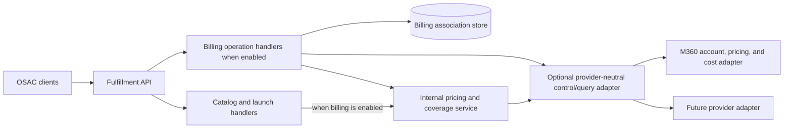

# OSAC Billing Integration and Catalog Pricing

| Field       | Value |
|-------------|-------|
| Author(s)   | Amit Oren |
| Jira        | [OSAC-3784](https://redhat.atlassian.net/browse/OSAC-3784), [OSAC-3793](https://redhat.atlassian.net/browse/OSAC-3793) |
| PRD         | [OSAC-3784 PRD](https://github.com/osac-project/enhancement-proposals/blob/main/enhancements/OSAC-3784-billing-integration-mvp/prd.md); [OSAC-3793 PRD](https://github.com/osac-project/enhancement-proposals/tree/main/enhancements/OSAC-3793-billing-catalog-pricing-integration/prd.md) |
| Date        | 2026-10-07 |

# 1. Overview

OSAC gets catalog prices and rate cards from its configured billing provider and does not store pricing details. The fulfillment service exposes one provider-neutral billing API, starting with Monetize360 (M360), so other providers can be added later. This API supports catalog pricing for VMaaS and CaaS. Billing for BMaaS remains OSAC-3795 and is out of this design.

# 2. Goals and Non-Goals

## 2.1 Goals

- Keep tenant-facing OSAC APIs and response models independent of M360 and other provider-native schemas.
- Allow a deployment to run without a billing provider while preserving normal catalog and resource fulfillment.
- Enforce a time-versioned 1:1 tenant-to-account association for this milestone (one active assignment per tenant and one active tenant per account). M360 has one `externalId` per account, so a later PRD 1:N model needs a real attribution protocol; it is not a uniqueness-constraint change and is out of this design.
- Resolve current account status and pricing/coverage in the backend, with tenant authorization enforced before provider calls.
- Provide Cloud Provider Admins a consolidated inventory of billable catalog dimensions and values, with references to the catalog items that use or offer each value, so provider rate-card completeness can be checked.
- Provide Cloud Provider Admins provider-neutral, currency-aware rate-card rows that the Rates UI can display by service, resource match, rate, and related catalog item.
- Enrich visible VMaaS and CaaS catalog list/get responses with read-time prices for default configurations, component details, account currency, freshness, and a price-may-vary indication.
- Keep catalog browsing available with or without billing. When a provider is configured, apply the coverage-gate table in §4.6: a coverage gap still blocks the gated write; a provider outage does not block launch or resize. Catalog items whose `metadata.tenant` is the reserved `shared` or `system` tenant are not coverage-checked at publish; each tenant's launch is checked against that tenant's linked account.
- Preserve the existing metering delivery path and event schema. M360 attributes events using the current `externalId` mapping for the event's `tenant_id`, so this design does not promise event-time account attribution after reassignment.
- Return an estimate in the account currency and provider rate unit, with hourly and monthly recurring amounts normalized using a fixed 730-hour month where the rate is time-based.

## 2.2 Non-Goals

- Create billing accounts, author rate cards, edit provider catalog data, process payments, or issue invoices. Invoice **reads** remain a PRD story and stay in the API table; they are **not this increment**. The provider remains the invoice source of truth.
- Show account balances or rated transactions in the first billing UI slice.
- Persist provider catalog prices as OSAC catalog records or create a second M360 pricing client in the catalog server.
- Run several billing providers concurrently in one deployment; a deployment may have billing disabled or configure one provider. Switching provider at a period boundary is **unsupported this milestone**.
- Estimate one-time charges or claim that prospective estimates are provider-rated actual charges.
- Convert provider prices between currencies. If a provider amount's currency differs from the linked account `base_currency`, fail the gate or return `UNAVAILABLE` pricing; do not display that amount as the account currency.
- Apply an additional billing-rounding rule to provider amounts. Preserve decimal values; UI formatting to 2–3 fractional digits is sufficient, and configurable display precision is a nice-to-have.
- Price or gate BMaaS (OSAC-3795).
- Declare or gate non-metered add-ons, licenses, or setup fees. Coverage and catalog inventory in this increment are **metered** billable dimensions only.
- Implement OSAC-side billing audit storage or an audit List API. Those PRD stories move with the platform audit feature (§9.3) and are not closed here.
- Share one billing account across tenants (PRD 1:N).

## 2.3 Assumptions

- The configured billing provider returns pricing in the agreed currency for the linked account. OSAC uses that currency as the account currency. Currency conversion is a non-goal; a mismatch **fails** rather than being displayed as the account currency.
- Provider price values are preserved as decimal amounts without an additional OSAC rounding step. The UI may display 2–3 digits after the decimal point; making that display precision configurable is a nice-to-have.
- Billing may be unconfigured. This is a supported deployment mode, distinct from a configured provider that is temporarily unavailable. The UI skip signal for disabled billing is `BillingProviderStatuses.Get` → `NOT_CONFIGURED`. An empty `BillingAccounts.List` does not mean billing is disabled.

# 3. Motivation / Background

The billing UI currently reads M360-shaped data directly and calculates launch estimates locally. That couples OSAC clients to M360 account identifiers and rate-card details, and it cannot enforce the same policy for API, CLI, catalog publication, and launch.

The backend already has an M360 usage adapter in `osac-metering`, but no account association model or billing query API. Fulfillment-service is the public API, persistence, and authorization boundary; the metering adapters own downstream provider usage submission. The design adds control/query operations to fulfillment-service while keeping usage delivery in osac-metering.

The reviewed M360 documentation describes account status, service rates, and contract exceptions, but no prospective quote endpoint. OSAC therefore matches documented provider rate rules to billable components and presents a clearly labeled estimate; M360 remains the source of truth for actual rating and charges. OSAC does not interpret arbitrary provider formula text. Any 730-hour projection is labeled as an OSAC estimate, separate from provider-supplied rates. The UI does not match rate rules or sum components locally.

# 4. Design

## 4.1 Architecture



OSAC clients use the fulfillment-service API. Fulfillment-service enforces authorization and tenant scope. When billing is disabled, catalog and resource operations continue without pricing or billing gates.

Fulfillment-service calls the configured provider through a provider-neutral adapter. Usage continues through `osac-metering` and its existing event format. M360 maps each event's `tenant_id` through the account's current `externalId`; late events after reassignment use that current mapping.

When billing is configured, catalog reads use the shared pricing resolver and include its result. OSAC does not store the resolved prices. When billing is disabled, catalog responses omit pricing.

### Pricing resolution

1. Check the linked account for a contract effective on the requested date.
2. If a contract exists, resolve its pricing. For M360, a contract may inherit the service catalog price when no exception rate is defined.
3. If the provider confirms that no contract applies, use the service's default rate card.
4. If the contract lookup fails or returns an unexpected ambiguous result, return an error. Do not fall back to the default rate card.
5. Resolve rates in the account's currency. A missing **metered** component rate is a coverage gap on tenant-owned publish and on launch/resize. OSAC matches provider-supplied rate rules and may calculate a clearly labeled prospective estimate; the provider rates actual usage.

### Day-one account path

OSAC does not create billing accounts.

1. The Cloud Provider Admin creates the account **in M360**.
2. With billing configured, fulfillment **discovers** accounts through the provider list API and stores `billing_account` rows, exposed as `BillingAccounts.List`.
3. The Cloud Provider Admin **assigns** a tenant with `TenantBillingAssignments.Create` / `Update`.
4. Enabling billing does not auto-create an account or assignment per existing tenant.
5. No assignment, or an assignment that is not `CONNECTED` (including `PENDING`), fails gated publish/launch with `BILLING_ACCOUNT_UNAVAILABLE`, not `BILLING_COVERAGE_GAP`.

## 4.2 Data Model / Schema Changes

The following tables describe the logical fulfillment-service data model, not protobuf field layouts or database types.

### `billing_account`

Stores the OSAC-side record for an account discovered from the configured billing provider.

This record is created only when a provider is configured and an account is discovered. No billing-account or tenant-assignment rows are required when billing is disabled.

| Field | Description |
|---|---|
| `id` | OSAC-generated opaque identifier used by APIs and assignments; it is not the provider's account ID. |
| `provider_key` | Identifies the configured billing adapter, such as M360. Provider configuration stays server-side. |
| `provider_account_reference` | Provider-native account ID used for backend calls; it is not returned to ordinary clients. |
| `display_name` | Provider-supplied account label shown in authorized OSAC account views. |
| `base_currency` | Immutable ISO-4217 currency code used to interpret prices and costs. |
| `status` | Last observed normalized state: `ACTIVE`, `INACTIVE`, or `UNKNOWN`. |
| `status_observed_at` | Time the provider status was last checked, so its freshness is visible. |

Provider credentials are not fields in this table; they remain in the configured Secret mechanism. Account metadata is refreshed from the provider. Rate-card values, estimates, actual costs, and rated transactions are not persisted as OSAC-owned prices.

### `tenant_billing_assignment`

Stores each time-bounded association between an OSAC tenant and a billing account. A new row is created when an association starts; reassignment closes the old row and creates a new one so the history remains auditable.

| Field (proposed name) | Description |
|---|---|
| `assignment_id` | Unique OSAC identifier for this particular assignment record. It distinguishes this link interval from later links for the same tenant and account, and lets audit/reconciliation records refer to the exact assignment. |
| `tenant_id` | OSAC tenant whose usage and billing profile use this assignment. |
| `billing_account_id` | Reference to `billing_account.id` for the account assigned to the tenant during this interval. |
| `effective_from` | Timestamp at which this tenant/account assignment became active. |
| `effective_to` | Timestamp at which this assignment stopped being active. `NULL` means it is the current assignment. |
| `connection_state` | OSAC's normalized state for synchronizing the association with the provider, such as `PENDING` or `CONNECTED`. `PENDING` means the provider mapping has not yet been verified. |
| `created_by` | Authenticated OSAC principal that created the assignment. |

For this milestone, enforce at most one active assignment per tenant and at most one active tenant per billing account. Close the old assignment and create its replacement in one database transaction. Assignment **history** stays time-versioned. A future 1:N product model is out of this design; relaxing the account-side uniqueness check would not produce shared-account attribution because M360 has one `externalId` per account.

Do not add an assignment audit-correlation field in this design. Billing audit is deferred with the platform audit feature in §9.3.

### API schema boundary

Fulfillment-service protos define the API contract; REST is generated through CleanAPI. This design names services and methods without listing every proto field or field number. Tenant assignments follow OSAC `Metadata`/`Spec`/`Status` conventions and reconcile provider state; account, catalog, rate-card, and cost read models may be flat. Proto and JSON field names use `snake_case`; enums use a type-prefixed `*_UNSPECIFIED = 0` value. Use `buf.validate` for required identifiers, currencies, and time ranges. The methods listed in §4.3 are the intended CleanAPI surface; reconciliation signals and provider-native references remain private. Audit schema remains deferred under §9.3.

Use a durable reconciliation record for provider-link updates. Before setting M360's `externalId`, read the account: an existing value equal to this tenant is idempotent success; any other non-empty value fails with `ACCOUNT_ALREADY_BOUND` and is never overwritten. Use conditional update if supported. Otherwise, leave the assignment `PENDING` until a read-back verifies the value, and reconcile races or lost updates. Mark it `CONNECTED` only after verification. Only Cloud Provider Admins may create or replace links; `tenant_id` is not an authorization credential. Account reassignment closes the old effective interval and creates the new one at the operation's effective time. Tenant deletion revokes normal tenant access immediately and retains the association as a read-only tombstone until provider retention permits cleanup. Suspension does not change the account association or provider account status. Historical OSAC assignments support history only; M360 uses the current `externalId` mapping for usage events and the current event format cannot target the historical account.

Rate-card snapshots, actual costs, balances, invoices, and rated transactions are not stored in this schema. Cost, invoice, and charge data are returned from the provider, subject to its retention and supported read capabilities.

## 4.3 API Changes

Fulfillment-service protos define the API contract. CleanAPI generates REST endpoints from the proto annotations; clients use the fulfillment API rather than provider routes. These proposed services use standard methods and provider-neutral responses. Tenant assignments are OSAC objects with desired and observed state; provider, catalog, rate-card, cost, and invoice reads are flat read models. Assignment reconciliation has a private `Signal` method. Public exposure is controlled through CleanAPI; provider-native identifiers and credentials remain private.

**This increment:** `BillingProviderStatuses.Get`, `BillingAccounts.List`, `TenantBillingAssignments.*`, `CatalogPricingInputs.List`, `ProviderRateCardItems.List`, existing VMaaS/CaaS catalog `List`/`Get` pricing, coverage gates, `BillingCosts.List`. `PricingQueries.Create` and `PriceEstimates.Create` are backend evaluation APIs for a selected configuration; catalog cards use catalog `List`/`Get`.

**Kept, not this increment:** `BillingInvoices.List`/`Get`, `DraftCharges.List`, `BillingExports.Create`/`Get`. They remain in the table so later work does not invent a second contract. This increment does not implement them.

| Service and method | Caller | Contract |
|---|---|---|
| `BillingProviderStatuses.Get` | Cloud Provider Admin; Cloud Infrastructure Admin | Report `NOT_CONFIGURED` or normalized **account-API** health and supported capabilities. Available when billing is disabled. This is the UI skip signal for “billing off.” It is not usage-pipeline health. `usage_delivery_state` stays `UNKNOWN` in this design. Cloud Infrastructure Admins use metering lag/DLQ Prometheus metrics for delivery. |
| `BillingAccounts.List` | Cloud Provider Admin | List discovered accounts with opaque OSAC IDs, display name, normalized status, and base currency. Do not expose provider-native account references. An empty list means no discovered accounts; it does **not** mean billing is disabled. |
| `TenantBillingAssignments.List`, `Get`, `Create`, `Update` | Cloud Provider Admin | Read or change a tenant's time-versioned account assignment. Enforce the current 1:1 rule. Linking follows the read-before-write and verified-read-back protocol in §4.2. |
| `CatalogPricingInputs.List` | Cloud Provider Admin | List **metered** billable dimensions and all default or selectable values in draft and published catalog items, with the items that use or offer each value. Available when billing is disabled. Non-metered components are deferred. |
| `ProviderRateCardItems.List` | Cloud Provider Admin | Return provider rules as currency-specific, provider-neutral rows for the Rates UI. Preserve match conditions and rate unit; do not return raw provider payloads. With a tenant context, use its contract when present and the default service rate card only when the provider confirms no contract applies. |
| `PricingQueries.Create` | Authorized tenant caller or Cloud Provider Admin preview | Evaluate a declarative resource configuration and return component-level price and coverage results. Coverage means the provider has a rate for each required **metered** billable component. Synchronous; not stored. A configured provider is required. |
| `PriceEstimates.Create` | Authorized tenant caller or Cloud Provider Admin preview | Return a prospective recurring estimate in the account currency and provider rate unit. Not a charge or invoice. Preserve the provider amount and unit; label any 730-hour monthly projection as OSAC-derived. A configured provider is required. |
| Existing VMaaS and CaaS catalog `List` / `Get` methods | Callers already authorized to view the catalog item | Add optional default-configuration pricing when a provider is configured. Use the existing catalog methods; do not create a parallel catalog API. |
| `BillingCosts.List` | Tenant Admin; Tenant User for visible resources/projects; Cloud Provider Admin for assigned tenants | Return provider-calculated costs for the request `from_date`/`to_date` (the provider's billing period; OSAC does not invent a calendar). Group by service, resource, and project when those ids are on the line. Nested project visibility: skip rows the caller cannot see; do not fail the whole list on one unattributed line. Successful reads include `as_of` (OSAC fetch time). Under 1:1, if M360 omits tenant on a line, attribute it to the linked tenant; drop lines whose tenant id is present and differs. No account-balance API. |
| `DraftCharges.List` | Cloud Provider Admin | **Not this increment.** Read-only, tenant-scoped draft-charge view when the provider supports it. Unsupported capability returns `UNIMPLEMENTED/PROVIDER_CAPABILITY_UNSUPPORTED`, not an empty result. |
| `BillingInvoices.List`, `Get` | Tenant Admin; Cloud Provider Admin for assigned tenants | **Not this increment.** Read past invoices and itemized charge breakdowns from the provider, filtered to the authorized tenant. OSAC does not issue, modify, or persist invoices. |
| `BillingExports.Create`, `Get` | Cloud Provider Admin | **Not this increment.** Start and inspect an export for an authorized tenant and billing period when supported. |

`CatalogPricingInputs.List` is an OSAC projection, not a second catalog source of truth. For example, it can show that the value `fedora-16` is used by a VM catalog item.

The following example is a **`ProviderRateCardItems.List` response** (Cloud Provider Admin Rates UI). It is not a request body and not a catalog-card payload. The UI does **not** match rate rules or sum components from this JSON. Catalog list/detail and the provision wizard get evaluated prices from catalog `List`/`Get` (and `PricingQueries` / `PriceEstimates` if called). A configuration change issues a new backend request.

VMaaS is billed on `instance_type`. Image and boot disk appear as match keys only when the provider rule actually matches on them. `catalog_item_matches` may list `vm-fedora-small` without putting “small” in a second field.

```json
{
  "currency_code": "USD",
  "items": [
    {
      "service": "compute_instance",
      "resource": {
        "instance_type": { "operator": "EQUALS", "value": "small" },
        "image_ref": { "operator": "ANY" }
      },
      "rate": { "amount": "4.50", "unit": "hour" },
      "catalog_item_matches": ["vm-fedora-small"]
    }
  ]
}
```

The provider adapter translates each provider's serialized rate-card format into these rows. It does not evaluate arbitrary provider formula text; an unsupported rate-rule shape returns a safe unavailable result. A contract lookup failure or unexpected ambiguous result is an error; only a confirmed absence of an account contract selects the default service rate card.

Billing is optional per deployment. `BillingProviderStatuses.Get` reports `NOT_CONFIGURED`; provider-dependent methods return `FAILED_PRECONDITION/BILLING_NOT_CONFIGURED`. The OSAC-only catalog inventory remains available. Existing catalog methods return catalog data without pricing, and billing-specific publish/launch gates are skipped. Core authorization, catalog validation, and resource checks still apply.

Catalog pricing distinguishes current, stale, and unavailable results. A stale result may include its last known amount for browsing, but it is never treated as current and cannot satisfy a billing gate:

```json
{
  "pricing": {
    "status": "STALE",
    "currency_code": "USD",
    "components": [
      { "amount": "4.50", "unit": "hour", "description": "Compute instance" }
    ],
    "price_may_vary": false
  }
}
```

An `UNAVAILABLE` result has no amount. `as_of` is the time OSAC received a successful provider response. Set it only when catalog pricing `status=CURRENT` or a cost read succeeded now. `STALE` catalog prices omit `as_of`. If the provider supplies `fromDate` / `toDate`, expose them as an effective period, separate from `as_of`.

Provider capabilities for pricing and costs are reported explicitly. Draft charges, invoices, and exports are unsupported unless a later increment confirms the M360 contract. Never imply that an unsupported operation returned an empty successful result. Audit reads are deferred with the platform audit feature in §9.3.

## 4.4 Scalability and Performance

When billing is disabled, make no provider calls. Account, status, pricing, and cost reads use provider timeouts and retries; an open **pricing** circuit returns promptly for catalog browse. For catalog lists, use bounded parallel price lookups and a list-level timeout. Each lookup inherits the remaining time. If the timeout expires, return the catalog items: unfinished current prices are `UNAVAILABLE` without an amount, or use a retained amount only with `STALE` status. A billing-gated single-item publish or launch has its own timeout and requires a fresh provider check. Launch wrappers treat classified provider unavailability as allow; they do not treat `STALE` cache as coverage.

Cache successful catalog prices for five minutes. The cache key includes provider, **billing account**, catalog item id, a hash of the default configuration, and currency. A global item priced for one tenant must not be served to another. If refresh fails after the cache expires, show the retained amount as `STALE`; it remains useful for browsing but cannot pass a billing gate.

Keep the agreed provider retry policy (up to three retries) and **separate** OPEN-state circuit breakers for (1) pricing/coverage, (2) cost reads, and (3) usage submission. A cost-list 5xx must not open the pricing breaker or skip launch coverage. Suggested initial pricing-breaker thresholds remain advisory: five failed pricing requests within 30 seconds, open for 30 seconds, then allow one probe. Tune concurrency and provider rate limits during implementation.

Provider usage submission remains on the existing Kafka path and event schema. M360 maps the event's `tenant_id` through the account's current `externalId`; the current event format cannot route delayed usage to a historical assignment. Do not add tenant or account IDs as metric labels. Paginate cost reads.

## 4.5 Security Considerations

Provider calls stay server-side. Store credentials in the existing Secret mechanism; never return credentials, provider-native account references, contract identifiers, or rate-card identifiers to tenant-facing clients. Redact provider response bodies, invoice and charge lines, bearer tokens, and native account IDs from logs, metrics, traces, and API errors unconditionally. Use stable reason codes and correlation IDs for diagnostics; the shared client must never log raw bodies.

Every billing method has an explicit OPA allow-list. Application code also filters every read and write to the caller's authorized tenant and project set. Check catalog visibility before resolving a price. Validate identifiers, currencies, dates, and configuration values at the API boundary. Preserve provider amounts as decimal values and do not execute arbitrary provider formula text.

## 4.6 Failure Handling and Recovery

Coverage and outage policy:

| Situation | Resource create / billable update | Tenant-owned catalog publish (`metadata.tenant` is a customer tenant) | Catalog item in reserved `shared` or `system` tenant |
|---|---|---|---|
| Billing not configured | Skip gate | Skip gate | Skip gate |
| No connected assignment, or `PENDING` | Fail `BILLING_ACCOUNT_UNAVAILABLE` | Fail if published | Skip |
| Fresh rates, coverage gap or ambiguous | Fail `BILLING_COVERAGE_GAP` / `BILLING_RATE_AMBIGUOUS` | Fail same | Skip |
| Provider timeout, 5xx, open **pricing** circuit (`BILLING_COVERAGE_UNAVAILABLE`) | **Allow**, log warning. Do not treat `STALE` as coverage | Fail closed | Skip |
| Rates current and complete | Allow | Allow | Skip |

Do not check a default service rate card in order to publish a shared or system catalog item. Those reserved tenants are not billing accounts.

- **Billing is not configured:** status returns `NOT_CONFIGURED`; provider-dependent operations return `FAILED_PRECONDITION/BILLING_NOT_CONFIGURED`. Catalog reads omit pricing, and billing-specific publish/launch checks are skipped. Normal OSAC checks remain in force.
- **Provider is unavailable or a catalog timeout expires:** return catalog data. A cached amount may be shown with `status=STALE`; otherwise return `status=UNAVAILABLE` with no amount. Apply the table above for publish vs launch.
- **Rate coverage is missing:** return `BILLING_COVERAGE_GAP`; never turn a missing rate into zero. Contract lookup failure or an unexpected ambiguous result is an error, never a fallback to the default card.
- **Account is inactive or unknown:** reject a new assignment. For an existing assignment, show the state and block new billing-gated publication/launch. Do not suspend or stop existing resources.
- **M360 account link conflicts:** if `externalId` is already this tenant, treat the link as idempotent success. If it contains another value, fail with `ACCOUNT_ALREADY_BOUND`; never overwrite it. Keep the assignment `PENDING` until a provider read-back verifies this tenant. Reconcile conditional-update races without marking the link connected prematurely. `PENDING` blocks launch (`BILLING_ACCOUNT_UNAVAILABLE`).
- **Provider operation is unsupported:** report the capability in provider status and return `UNIMPLEMENTED/PROVIDER_CAPABILITY_UNSUPPORTED`, not empty data or simulated success.
- **Unauthorized tenant preview or hidden catalog item:** reject before calling the provider and disclose neither the item nor its price.
- **Usage submission:** if billing is configured, **keep submitting usage**. Rates are not required to emit. Deactivating an M360 account does not make OSAC stop emission. Existing resources keep running. Provider rejection handling stays the current metering adapter retry/DLQ policy. This design does not specify park-and-replay for an inactive-account 4xx.
- **Usage arrives after reassignment:** M360 applies the current `externalId` mapping. The design does not guarantee event-time account attribution for delayed events; retain OSAC assignment history.
- **Provider switch is unsupported this milestone.** One provider URL and Secret. Changing configuration away from M360 is a new config, not a period-boundary migrate. There is no dual-adapter window and no replay into a second provider. In-flight Kafka/DLQ is not drained by this design.
- **Export retries:** not this increment. If later implemented, use a stable idempotency key so a retry does not create a duplicate export.

## 4.7 RBAC / Tenancy

| Service and methods | OSAC persona | Scope enforced by application |
|---|---|---|
| `BillingProviderStatuses.Get` | Cloud Provider Admin; Cloud Infrastructure Admin | Deployment-wide status only. |
| `BillingAccounts.List`; `TenantBillingAssignments.List`, `Get`, `Create`, `Update` | Cloud Provider Admin | Provider-global account list; assignments limited to tenants the admin may manage. |
| `CatalogPricingInputs.List`; `ProviderRateCardItems.List` | Cloud Provider Admin | Deployment catalog/provider data. |
| `PricingQueries.Create`; `PriceEstimates.Create`; catalog `List` / `Get` | Tenant Admin; Tenant User; Cloud Provider Admin preview | Tenant callers see only visible catalog items and their own account pricing. Tenant Users can estimate only resources they may provision. Admin previews require an authorized target tenant. |
| `BillingCosts.List` | Tenant Admin | The caller's tenant and authorized projects. |
| `BillingCosts.List` | Tenant User | Only resources and projects the caller can access. |
| `BillingCosts.List` | Cloud Provider Admin | Only an explicitly authorized target tenant. |
| `BillingInvoices.List` / `Get`; `DraftCharges.List`; `BillingExports.Create` / `Get` | As in the API table | **Not this increment.** Same tenant filters would apply when implemented. |

Cloud Infrastructure Admin installs provider credentials through installer configuration; this is not a separate billing persona or API. Provider switch is unsupported this milestone. OPA allow-lists every method, and application code enforces the tenant/project filters even when OPA permits the role.

`billing_account` is provider-global and has no tenant-isolation annotation. Tenant assignments are keyed by `tenant_id`; tenant and owner-reference annotations apply only to tenant-owned assignment objects. Enforce at most one active account per tenant and one active tenant per account for this version. Historical assignments are visible only to Cloud Provider Admins. Deletion revokes tenant access immediately while retaining the assignment tombstone; suspension does not deactivate the provider account.

`shared` and `system` are OSAC reserved tenants for platform catalog (visible to everyone, or internal-only). They are not billing accounts and have no M360 `externalId`.

## 4.8 Extensibility / Future-Proofing

OSAC-facing services use opaque IDs, normalized status, currency and rate units, and provider-neutral price rows. Provider-specific account and rate-card formats stay behind adapters. Each provider adapter maps OSAC billable components to that provider's query shape and preserves provider-supplied amounts.

Fulfillment and metering may share one M360 HTTP helper module and the same Secret reference, URL, and version. They remain separate processes with **separate circuit breakers**, so a pricing or cost failure cannot open the breaker on usage submission. Fulfillment must not import the metering adapters package. Fulfillment owns billing APIs, authorization, assignments, and provider response mapping. Metering owns Kafka, usage-event translation, retries, and submission. The shared client must not log raw bodies (the current metering adapter putting response bytes into errors is a required fix when that helper is shared).

The time-versioned assignment model records history under a 1:1 active constraint. 1:N account sharing is out of this design. No provider change should expose native account or rate-card formats to OSAC clients.

# 5. Interface Changes

New billing methods are defined in fulfillment-service protos; CleanAPI generates their REST surface. Catalog pricing extends the existing VMaaS and CaaS catalog `List` and `Get` responses. The design adds account-assignment persistence and optional provider configuration, but does not change the metering event schema or store provider prices, costs, or invoices. The API and method summary is in §4.3.

| Interface change | User-story basis |
|---|---|
| Discover accounts and link a tenant through `BillingAccounts` and `TenantBillingAssignments` | Cloud Provider Admin: “I want each tenant associated with a billing account … so that charges land on the correct invoice.” Cloud Infrastructure Admin: “I want to install the billing provider connection as part of the OSAC installation.” |
| Check OSAC billable values and provider rate coverage with `CatalogPricingInputs` and `ProviderRateCardItems` | Cloud Provider Admin: “I want OSAC to prevent a resource type from being offered for provisioning until every one of its billable components has a rate in the billing system … and to alert me to any component lacking a rate.” This increment covers **metered** components. Non-metered add-ons/licenses/setup fees are deferred. |
| Enrich VMaaS and CaaS catalog reads and provide tenant-contextual previews | OSAC-3793 Tenant Admin / Tenant User: “I want to see the price of a VMaaS or CaaS catalog item available to my context before provisioning.” BMaaS catalog pricing is out of this design (OSAC-3795). |
| Provide a selected-configuration prospective estimate | OSAC-3784 Tenant User: “I want to view the estimated cost of the resources I have deployed.” The prospective configuration estimate is an additional agreed design capability; it is distinct from the PRD's latest-calculated-cost view. |
| Read tenant costs with `BillingCosts` | Tenant Admin: “I want to view my organization's accumulated costs for the current and past billing periods.” |
| Past invoices, draft charges, and exports | PRD stories remain. **Not this increment.** |

The provider-status read remains available when billing is disabled. Provider-dependent billing calls return `BILLING_NOT_CONFIGURED`; core catalog and fulfillment methods continue to work without pricing or billing gates. The catalog inventory is OSAC-only and remains available. Audit API and storage details remain deferred under §9.3 and are not closed by this EP.

# Drawbacks

- **Provider abstraction adds maintenance.** Normalized account, price, and charge contracts require adapters for each supported provider.
- **Provider latency affects catalog pricing and billing gates.** A list timeout preserves catalog browsing but may leave some prices unavailable. Launch continues on a classified outage; a coverage gap still blocks.
- **A stale amount can be mistaken for a current price.** The API marks it `STALE`, and it cannot pass a billing gate.
- **Prospective estimates can differ from actual charges.** Usage, non-recurring charges, and provider processing affect the final amount; the provider remains authoritative.
- **Reassignment cannot route delayed usage historically.** M360 uses the current `externalId` mapping for each event's `tenant_id`; OSAC assignment history does not change this behavior.
- **1:1 for this milestone.** The PRD allows 1:N; M360 `externalId` does not. Shared-account attribution is a follow-up.

# 6. Alternatives Considered

- **Expose M360 routes and fields directly to OSAC clients.** This would bind the API to M360 and prevent adding Red Hat Cost Management or another provider behind the same facade.
- **Require a provider quote API and omit estimates otherwise.** M360 has no documented quote API. The design instead matches documented provider rate rules and presents a prospective estimate; it does not interpret arbitrary formula text or claim to calculate actual charges.
- **Allow publish or launch with unresolved coverage.** A coverage gap still blocks. A provider outage does not block launch; tenant-owned publish on outage remains fail-closed because a new offer cannot be confirmed covered.
- **Publish shared catalog against the default service rate card.** Rejected. `shared` / `system` are not billing accounts.
- **Use M360's mutable `externalId` as the only assignment record.** OSAC keeps time-versioned assignments for its own history and synchronizes the current tenant ID to M360.
- **Add a separate pricing endpoint for each catalog item.** Existing catalog `List` and `Get` methods carry optional pricing, using bounded provider requests and a timeout.
- **Persist catalog prices in OSAC.** Prices remain provider-owned. A short-lived cache supports browsing and clearly labels old values as `STALE`.
- **Dual adapters across a provider-switch boundary.** Rejected for this milestone. One URL, one Secret, switch unsupported.
- **Treat an empty account list as billing disabled.** Rejected. Disabled billing is `NOT_CONFIGURED` on provider status.

# 7. Observability and Monitoring

Expose normalized provider status and the last successful **account-API** health check to Cloud Provider Admins. Treat `NOT_CONFIGURED` as an expected state. Do not set this RPC to `DEGRADED` because usage delivery is stuck; fulfillment has no metering lag signal in this design. Track provider request latency and failures, rate-resolution outcomes, catalog-pricing states, and assignment-sync failures on fulfillment. Usage-delivery lag and DLQ depth stay on the metering adapter. Metrics may use provider and operation labels, but not tenant, account, resource, or project identifiers. Logs, traces, and API errors contain stable reason codes and correlation IDs only; redact provider payloads, credentials, financial lines, and native account IDs unconditionally.

# 8. Impact and Compatibility

The change adds fulfillment billing methods, account-assignment persistence, provider configuration, OPA rules, and optional pricing on existing VMaaS and CaaS catalog methods. BMaaS pricing and gates are out of this design (OSAC-3795). Deployments without a provider keep existing catalog and fulfillment behavior; no billing credentials or provider calls are needed. OSAC does not store provider prices, costs, charges, or invoices.

M360 continues to map the existing metering event's `tenant_id` through the account's current `externalId`; the event schema does not change. Delayed usage after reassignment is not guaranteed to use the historical account. Existing assignments preserve OSAC history, and pre-activation usage is not billed retroactively. Invoice, draft-charge, and export APIs stay in the contract for later work; this increment does not implement them.

# 9. Open Questions

## 9.1 What does M360 account deactivation do to usage ingestion and rating?

- **Status:** Resolved for OSAC behavior.
- **Owner:** OSAC billing/provider integration team and Monetize360 integration contact
- **Decision:** If billing is configured, OSAC keeps submitting usage. Rates are not required to emit. Existing resources keep running. M360 rating after deactivation is undocumented; provider rejection handling stays the current adapter retry/DLQ policy. Park-and-replay for inactive-account 4xx is out of this design.

## 9.2 What timestamp should OSAC expose as `as_of` when M360 has no equivalent?

- **Owner:** OSAC billing/provider integration team
- **Status:** Resolved.
- **Decision:** `as_of` is the time OSAC received a successful provider response. Set it only on current catalog prices and successful cost reads. `STALE` omits `as_of`. Provider `fromDate` / `toDate`, when present, are an effective period, not `as_of`.

## 9.3 How should OSAC audit billing actions?

- **Status:** Deferred to the platform audit feature.
- **Owner:** OSAC billing feature owners with the platform audit/security owners
- **Impact:** The PRD still requires audit entries for provider install, tenant-to-account linking, and (later) draft-invoice read/export. This EP does not select storage, taxonomy, retention, authorization, or a read surface, and does not close those stories. No billing-specific audit table is specified here.

# Graduation Criteria

Graduation criteria will be defined when targeting a release. Expected stages: Dev Preview -> Tech Preview -> GA based on production deployment feedback.
